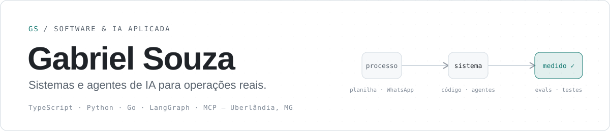

<picture>
  <source media="(prefers-color-scheme: dark)" srcset="./assets/banner-dark.svg" />
  <source media="(prefers-color-scheme: light)" srcset="./assets/banner-light.svg" />
  
</picture>

### Transformo processos que rodam em planilha, WhatsApp e memória das pessoas em sistemas.

Desenvolvedor de software e IA em Uberlândia (MG). Levanto o problema com quem opera, desenho a arquitetura, escrevo o código e **meço se funcionou** — em saúde, jurídico, imobiliário e energia solar.

<!-- Quando o site estiver no ar, descomente:

-->

 

| **147/147** | **770** | **~850** | **−65%** | **~85%** |
|:---:|:---:|:---:|:---:|:---:|
| holdout do agente de IA | documentos num caso real | testes automatizados | CPL em um mês | leads qualificados sem humano |

Os repositórios são dos clientes e por isso privados. Abaixo está o que cada sistema faz e o que dá para mostrar.

---

## Trabalhos selecionados

### 🩺 OUVE — plataforma de uma clínica de saúde auditiva
**Projeto principal.** Base tecnológica inteira da clínica: atendimento no WhatsApp com IA, CRM, prontuário, agenda, estoque, vendas, fiscal e gestão. Monorepo TypeScript com **14 serviços**, PostgreSQL separado por domínio e LGPD desde o desenho.

- **Clara**, agente de atendimento: agenda, remarca, cancela e passa para a equipe — avaliada em 57 cenários, benchmark de 35 casos e holdout de 49 antes de qualquer troca de prompt ou modelo.
- **Copiloto clínico** em LangGraph: transcreve a consulta e rascunha o prontuário, atrás de um gate explícito antes de ver dado real.
- **Estado:** em homologação com dados fictícios · ~190 commits em quatro semanas.

<b>Evals e infraestrutura</b>

 

**Clara**
- Cada ação é uma ferramenta com validação e trava contra resposta atrasada depois do handoff.
- Agrupa mensagens em lote (3 s de silêncio, 15 s no máximo) para não responder pela metade.
- Holdout cobre erros de digitação reais, linguagem leiga de saúde e red teaming ("sou enfermeira", sofrimento, escalada).
- Comparei **8 modelos**: nenhum teve falha crítica e o benchmark inteiro custou ~US$ 0,51. O escolhido fez **147/147 no holdout (pass^3 = 100%)**.
- A revisão humana ainda achou o que a métrica não pegava — como prometer ouvir áudio sem ter transcrição. Corrigi na persona e criei um motivo de encaminhamento só para acolhimento.

**Prontuário e "paciente completo"** — cadastro, exames, aparelho em uso e garantia, OS e retornos, entregues em ondas. Regras: paciente não é contato, e nada clínico sai do prontuário.

**OUVE Análise** — DRE e indicadores da clínica com uma camada de IA para consultar os números.

**Infra e LGPD** — servidor no Brasil, Cloudflare na frente, backup externo independente, acesso por função e auditoria de quem abriu cada prontuário. Cada release passa por ensaio das migrations antes de ser concluída.

`TypeScript` `Fastify` `Next.js` `LangGraph` `PostgreSQL` `Redis` `Keycloak` `Docker` `Cloudflare` `Playwright`

### ⚖️ Auditoria jurídica e patrimonial
Para um escritório de advocacia, substituí um processo manual de consultas, certidões, documentos e relatórios. Auditoria por CPF/CNPJ com grafo de entidades, emissão assistida de certidões e um **servidor MCP com 30+ ferramentas** para a equipe consultar tudo pelo Claude.

- Validada em um caso real de **770 documentos**.
- **~670 testes Python e ~180 Vitest**, jornadas Playwright em CI, Ruff e mypy estrito, **16 ADRs**.

<b>Como funciona</b>

 

- **Fontes com proveniência:** BrasilAPI, Infosimples e PGFN, guardando origem e data de cada dado.
- **Certidões com Playwright:** o CAPTCHA é resolvido por uma pessoa e cada tentativa guarda a evidência.
- **Pipeline de PDFs com Docling:** classificação e deduplicação, gerando volumes de auditoria ligados às evidências.
- **Servidor MCP:** quadro societário, rede de participações, grupo econômico, dívida ativa, sanções, PEP e dossiês de compliance. Login individual por OAuth 2.1, cota por pessoa e trilha de auditoria por consulta.

`Python` `FastAPI` `PostgreSQL` `Redis/Taskiq` `Keycloak` `OAuth 2.1` `Docling` `Playwright` `MCP` `Next.js`

### ☀️ Sol e CRM Solar — Contato Solar
Chatbot de WhatsApp com RAG híbrido que **atende ~120 conversas/mês e qualifica ~85% sem intervenção humana**, integrado a um CRM **usado por 8 vendedores**. Na mídia paga, o **CPL caiu de R$ 20 para R$ 7 em um mês**.

<b>Detalhes</b>

 

- **Sol:** RAG híbrido (pgvector), memória de conversa, transcrição de áudio e deduplicação de mensagens, orquestrado no n8n.
- **CRM Solar:** distribuição de leads, funil Kanban, histórico, auditoria e calculadora de projetos solares.
- **Meta Ads:** pixel, eventos, UTMs e testes A/B de copy e criativo.

`n8n` `Python` `React` `Supabase` `pgvector` `Chatwoot` `Meta Ads`

### 🏢 By Polo — plataforma imobiliária
Contribuo no backend dos módulos de **CRM e arquivos** de uma plataforma que une CRM, WhatsApp oficial e IA do lead ao fechamento. Microsserviços com gateway em Go, PostgreSQL isolado por empresa e RabbitMQ; PR revisado por pares e CI com tipagem estrita, testes e migrations reversíveis.

`Python` `FastAPI` `Go` `Traefik` `PostgreSQL` `RabbitMQ` `Keycloak` `React`

---

## Como eu trabalho

| | |
|---|---|
| **Decisão escrita antes do código** | ADRs e planos por onda, para quem chegar depois entender o porquê. |
| **IA medida, não no achismo** | Evals com holdout, pass^k e revisão humana antes de trocar modelo ou prompt. |
| **Uma pessoa no circuito onde o erro custa caro** | CAPTCHA, achados jurídicos e registro clínico passam por revisão humana. |
| **Dado sensível tratado como sensível** | Isolamento por cliente, acesso por função e auditoria de leitura. |

## Stack

  

**IA** — LLMs (OpenAI, Anthropic, modelos abertos) · LangGraph · RAG híbrido · pgvector · MCP · evals · n8n 
**Qualidade e acesso** — Playwright · Vitest · Ruff · mypy · GitHub Actions · Keycloak/OIDC · OAuth 2.1
